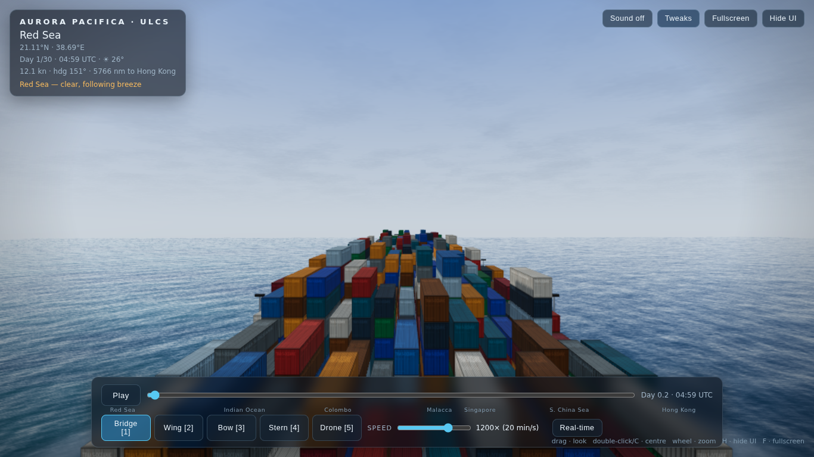
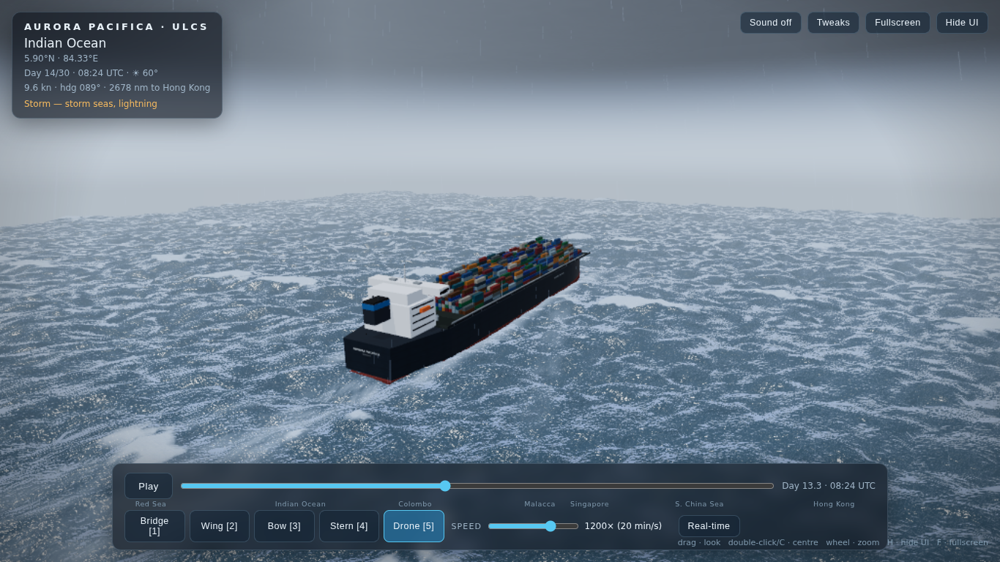
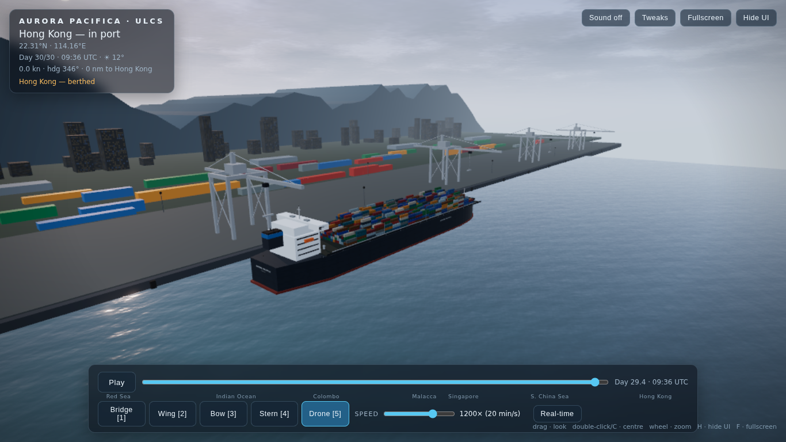
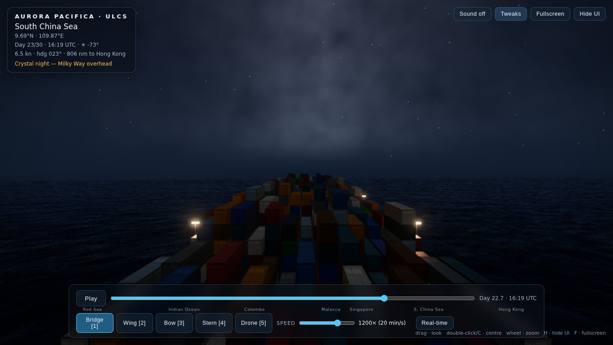

# AURORA PACIFICA — 30 Days Timelapse at Sea

A WebGPU container-ship timelapse from the bridge of a 330 m ULCS, recreating
JeffHK's 30-day voyage: **Red Sea → Gulf of Aden → Indian Ocean → Colombo →
Malacca Strait → Singapore → South China Sea → Hong Kong**.

FFT ocean (Phillips spectrum, baked Tessendorf atlas tiled at three scales —
the Sea of Thieves approach), physical sun/moon from the ship's real
lat/lon, volumetric raymarched clouds, voyage-driven weather with storms,
rain and lightning, AIS-like traffic, ports and landfall, day/night cycle
with stars and the Milky Way. Timelapse by default (30 days ≈ 36 min),
real-time at one click.









## Run it

**Hosted:** <https://laurentbecherel.github.io/aurora-pacifica-timelapse/>
(Chrome/Edge with WebGPU recommended. The Cinematic tier targets a 3080 at
4K; Balanced keeps the same scene at 75% render scale with fewer cloud steps
if a particular 4K display/driver combination needs more headroom.)

**Locally:**

```bash
node server.mjs 8080        # then open http://localhost:8080
```

No build step and no dependencies; three.js 0.180.0 loads from jsDelivr.

## Controls

| Input | Action |
|---|---|
| Space / Pause button | Play · pause the voyage |
| Scrub bar | Jump anywhere in the 30 days |
| Speed slider / Real-time | 1× … 20000× (timelapse default 1200×) |
| 1–5 or camera buttons | Bridge · Wing · Bow · Stern · Drone |
| Drag | Look around; in Drone, orbit the ship |
| Double-click / C | Re-centre the view |
| Wheel | Zoom (field of view) |
| Tweaks | Weather presets or manual sea/cloud/wind, wave height, foam, stabilisation, exposure, quality tier, bloom/traffic/rain toggles |
| Sound | Procedural swell, wind, rain and thunder |
| H / Hide UI | Hide the interface; tap the view to restore it · F fullscreen |

## How it works

See [ARCHITECTURE.md](ARCHITECTURE.md) for the full system breakdown and
[DEVLOG.md](DEVLOG.md) for the build journal. In one paragraph: a pure-JS
simulation backend (`src/sim` — voyage, solar, weather, traffic, ship
motion; unit-tested with `node tests/sim.test.mjs`) drives a three.js
WebGPU/TSL renderer; a Web Worker bakes the FFT ocean atlas and cloud noise
volume at load (`node tests/fft.test.mjs` validates the bake in ~4 s). The
FFT spectrum is tiled at ship scale (340/76/10 m) over a coherent swell
train, and the cloud volume is sampled by height through the cloud layer so
cumulus and storm towers have vertical body. The voyage opens on the first
Red Sea dawn and loops after Hong Kong.

## Tests

```bash
node tests/sim.test.mjs         # route, solar, weather, traffic, motion
node tests/fft.test.mjs         # FFT calibration (Hs), determinism, bake timing
node tests/regressions.test.mjs # depthTexture crash guard, shared swell
```
